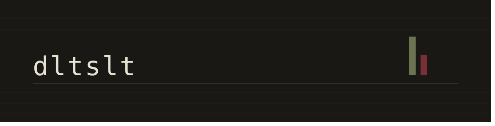

  

### Core Competencies & Background

* **Technical Focus:** Systems programming, containerized infrastructure, and orchestrating local AI/agentic workflows.
* **Analytical Foundation:** Problem structuring, data synthesis, requirements engineering, and stakeholder communication.
* **Professional Background:** Nine years in financial and business consulting. Graduate of Vienna University of Economics and Business.

### Software Engineering — 42 Vienna (Common Core)

Hands-on software development in a UNIX environment, driven by independent implementation and continuous peer evaluation:

* **Solution Design & Implementation:** Architecture and low-level implementation of systems in C and C++ from scratch against strict technical constraints.
* **Peer Review & Verification:** Regular live code defenses evaluating memory safety, edge-case handling, and architectural clarity.
* **Collaborative Engineering:** Team-based software delivery using Git workflows, strict coding norms, and shared technical ownership.
* **Self-Directed Study:** Systematic breakdown of unfamiliar technologies into working mental models and mapping technical unknowns.

### Selected Educational Work

- **[Nuxt 4 Prototyping Platform](https://github.com/dltslt/42-tc-proto-docker)** — Containerized control plane running isolated Nuxt 4 prototypes in parallel with shared DB engines, `pnpm` store deduplication, and `Makefile` CLI automation. (`Docker Compose`, `GNU Make`, `pnpm`, `PostgreSQL`, `MongoDB`)
- **[Inception](https://github.com/dltslt/42-Inception)** — Custom Alpine Linux container stack with NGINX SNI + Caddy subdomain TLS routing, Docker secrets, persistent volumes, and automated `WP-CLI` setup. (`Docker`, `Alpine Linux`, `Caddy`, `NGINX`, `MariaDB`, `Redis`, `Adminer`, `Portainer`)
- **[ft_irc](https://github.com/francescoPagliaPersonal/ft_irc)** — RFC-compliant multi-client IRC server implemented from scratch with non-blocking `epoll()` I/O multiplexing and TCP sockets. (`C++98`, `Network Programming`, `POSIX Sockets`)
- **[cub3d](https://github.com/francescoPagliaPersonal/cub3d)** — First-person 3D raycasting engine written in C using MinilibX, implementing textured wall projection, sprite rendering and more. (`C`, `Raycasting`, `MinilibX`)
- **42 Weekend Sprints:**: [Reverse-Engineering](https://github.com/YousefElghanam/Retro-MFA), [Unit-Tester](https://github.com/itislu/42-Rush-libunit), [2048](https://github.com/cseriildi/2048), [Nim](https://github.com/itislu/42-Rush-AlCu)

### Independent Projects — Agentic Systems & Local AI

* **Workflow Integration:** Applied usage of local LLMs and agentic coding workflows to accelerate full-stack prototyping and system automation.
* **Current Architecture Project:** Design of a general-purpose personal agentic framework integrating a tailored memory layer for persistent context retrieval.
